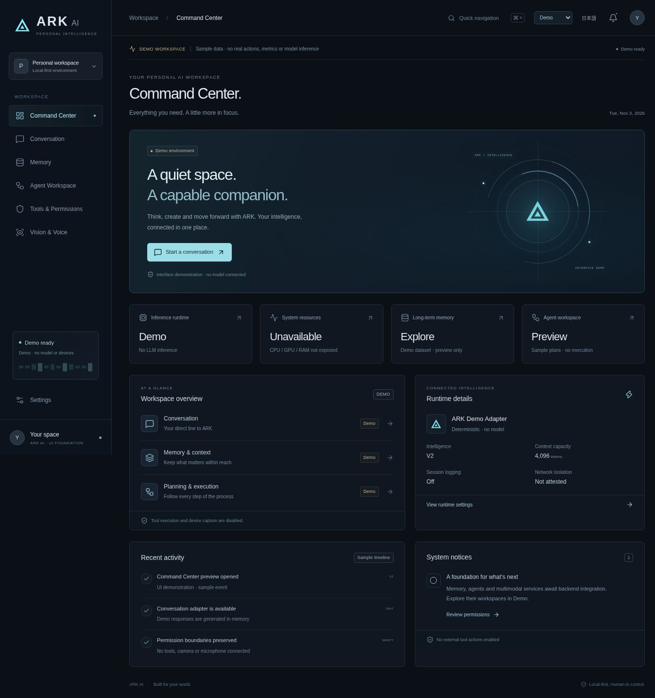

# Next UI verification and screenshots

Session date: **2026-11-03**. Source baseline:
`main@7a843f17eb96ed13d66f23b58b06406b3002e405`.
These are development verification records for the new UI foundation, not frozen
V1/V2/Local UI evidence or an official milestone declaration.

## Automated checks

| Check | Observed result |
| --- | --- |
| Strict TypeScript | PASS |
| ESLint, including hook rules | PASS, zero warnings |
| Frontend adapter/hook/screen interactions | 53 tests PASS |
| Production build | PASS; approximately 286 KB JS / 89 KB gzip and 52 KB CSS / 12 KB gzip |
| Python suite, including existing frozen-evidence tests | 169 tests PASS |
| Ruff | PASS |
| Existing Local UI JavaScript tests | 6 tests PASS |
| Existing packaged Local UI smoke | PASS, explicitly mock only |
| Actual TypeScript Local Adapter → Python HTTP/V2 Echo session | PASS: Japanese response, stale request 409, history preserved, Reset |
| Frozen boundaries | Existing `src/ark/ui`, V1/V2, contracts, evaluation and `evidence/` have no diff |

The independent frontend workflow repeats Typecheck/Lint/Tests/Build and starts
a dedicated mock runner for the real HTTP adapter check. Existing six Python CI
matrix jobs are preserved. GitHub Actions status must be checked on the final PR
head separately; these local results do not assert that a remote job completed.

## Browser review

The managed Chrome browser loaded the actual Vite app, not a raster mockup.
All seven navigation targets were opened. Verified Japanese message send,
pending-state control locking, completed Echo display, Reset review/confirmation,
memory search and provenance, sample Plan DAG, tool approval rehearsal, disabled
camera/microphone/screen controls, Japanese language and Deep Navy theme.

At a **390 × 844 CSS-pixel iframe viewport** (375-pixel layout width after the
browser scrollbar), all seven screens had `scrollWidth == clientWidth == 375`.
The mobile drawer opened, moved focus into navigation, closed after navigation,
and exposed the selected screen. This verifies responsive rendering in desktop
Chrome, not a native mobile-device or Windows IME test. An ephemeral responsive QA
wrapper was removed from source and the final build.

Selecting Local API on the standalone Vite server produced an explicit connection
error and retained Local API mode. Memory showed Unavailable with no fixture
records. No fallback to demo data occurred. Actual same-origin backend behavior
was separately verified through real socket/API tests and the TypeScript HTTP
smoke script; the cloud browser did not connect to the protected loopback runner.

Browser findings corrected during review: readable text sizing, page movement on
conversation updates, keeping the header visible during route changes, true
loading/disconnected/mock labels, and mobile navigation keyboard containment.

## Screenshots

Every screenshot below is **Demo**, with no real model inference, resource
measurement, agent execution, approval grant or device observation. The Tool
image captures the approval-preview modal; the Memory image captures a search.

| View | Screenshot |
| --- | --- |
| Command Center | [command-center.jpg](command-center.jpg) |
| Command Center, Japanese / Deep Navy | [command-center-ja.jpg](command-center-ja.jpg) |
| Conversation | [conversation.jpg](conversation.jpg) |
| Memory | [memory.jpg](memory.jpg) |
| Agent Workspace | [agents.jpg](agents.jpg) |
| Tools & Permissions | [tools.jpg](tools.jpg) |
| Vision & Voice | [vision-voice.jpg](vision-voice.jpg) |
| Settings, Japanese / Deep Navy | [settings-ja.jpg](settings-ja.jpg) |
| Responsive, Japanese / Deep Navy | [mobile-ja.jpg](mobile-ja.jpg) |

## Remaining integration gates

Run the new built UI on the target Windows PC with its existing GGUF and TOML to
verify real inference, native IME, offline cold start and normal daily workflows.
No real-model quality/performance/offline claim is made here. The old official
PASS and evidence remain untouched.

Memory, Planner, ToolRegistry, Action Audit, telemetry and multimodal services
need explicit read-only HTTP contracts before integration. WRITE operations,
durable approvals, agent dispatch/recovery, streaming/cancellation, training and
Candidate promotion remain disabled. See the
[architecture and next integration plan](../NEXT_UI_ARCHITECTURE.md).
